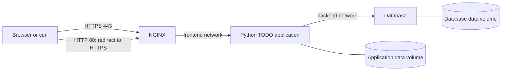
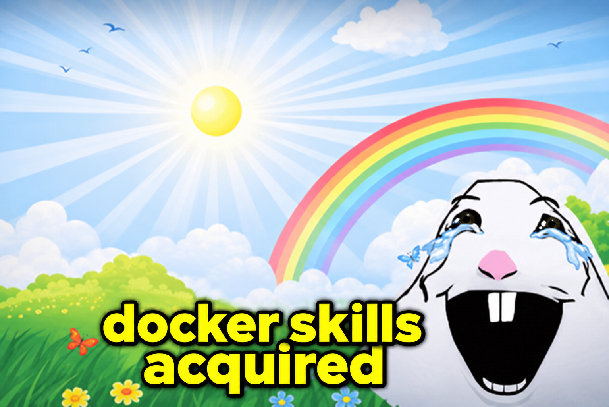

# Beginner Project 05 - Containerization

## Subject

Build and containerize a simple Python TODO application and its database using a reproducible Docker Compose stack.

## Introduction

This specification adapts the Club-cloud **Beginner Project 02 - Containerized Infrastructure** assignment to this learning path. The mandatory stack uses your own application image and allows official, versioned NGINX and database images. Building every service from a base operating-system image is an optional challenge.

I advise you to watch [Containers From Scratch — Liz Rice (GOTO 2018)](https://www.youtube.com/watch?v=8fi7uSYlOdc) before starting the project. Liz builds a small container in Go to explain how Linux isolates processes and controls their resources, giving you a foundation for the Docker work below.

For more detailed explanations of core Docker concepts, watch [this Docker concepts video](https://www.youtube.com/watch?v=3c-iBn73dDE) before starting the project or refer to it while you work.

## Learning Goals

- Explain the difference between an image (a packaged filesystem and startup instructions) and a container (a running instance of an image).
- Build an application image with a Dockerfile and manage several services with Docker Compose.
- Route HTTPS traffic through a reverse proxy, which receives client requests and forwards them to the application.
- Connect services using Docker networks and service-name DNS, without publishing internal ports.
- Persist database and application files with Docker-managed named volumes.
- Configure services without embedding secrets in source code or images.
- Distinguish service readiness, health checks and automatic recovery after a process crash.

## Prerequisites and Scope

- Complete Projects 00-04, or demonstrate equivalent Linux, networking, TLS, Git and automation knowledge.
- Run the stack inside a VM or an instructor-approved Linux environment. The commands below run inside that environment unless another location is stated.
- Install Docker Engine, the Docker Compose v2 plugin (`docker compose`), Git, Make, curl and OpenSSL. Record the Docker and Compose versions used in your submission.
- Ensure host ports 80 and 443 are available. Stop or reconfigure an existing web server if it already uses them.
- Build a simple TODO application with Flask, Django, FastAPI or another instructor-approved Python framework. Explain your choice.
- Use MariaDB as the reference database, following the Club-cloud assignment. An instructor-approved PostgreSQL alternative is acceptable if it satisfies the same persistence, user and validation requirements.

The mandatory outcome is one working application on one Docker host. Kubernetes, a public cloud deployment and a CI/CD pipeline belong to later projects.

## Required Architecture



Use the Compose service names `nginx`, `app` and `db` so the operational commands below are consistent.

| Service | Responsibility | Networks | Published host ports | Persistent data |
| --- | --- | --- | --- | --- |
| `nginx` | Terminate TLS and forward requests to `app`. | `frontend` | 80 for redirects; 443 for HTTPS. | None required. |
| `app` | Serve the TODO application and access the database. | `frontend`, `backend` | None. | A named volume for generated task exports. |
| `db` | Store TODO tasks and enforce database permissions. | `backend` | None. | A dedicated named volume for database files. |

The application listens on an internal port such as 8000. It connects to `db` on the database's internal port, such as 3306 for MariaDB. Inside a container, `localhost` refers to that container, so it is not the address of another service. See [Compose networking](https://docs.docker.com/compose/how-tos/networking/).

## Mandatory Work

### 1. Repository Layout and Automation

Keep runtime configuration and application source under `srcs/`. Use this structure, adapting framework-specific filenames as needed:

```text
.
├── README.md
├── Makefile
├── .gitignore
├── evidence/
└── srcs/
    ├── compose.yaml
    ├── .env.example
    ├── app/
    │   ├── Dockerfile
    │   ├── .dockerignore
    │   ├── requirements.txt
    │   └── ... application source and database initialization ...
    ├── nginx/
    │   └── ... configuration and any environment templates ...
    ├── db/
    │   └── ... initialization SQL or scripts, if required ...
    └── tls/
        └── ... locally generated certificate and private key; not committed ...
```

The real `srcs/.env`, secret files and generated TLS material are created locally. Commit examples and generation instructions instead. A lockfile appropriate to your dependency manager may replace `requirements.txt`.

Provide these root Makefile targets:

| Target | Required behavior |
| --- | --- |
| `make up` | Build the application image and start the stack in the background. |
| `make down` | Stop and remove project containers and networks while preserving named volumes. |
| `make logs` | Follow logs from all services, with a useful recent history. |
| `make clean` | Remove this project's containers, networks and persistent volumes. Clearly announce that data will be deleted. |

Each target must use the same Compose file, environment-file path and project identity. For example, use `docker compose --env-file srcs/.env -f srcs/compose.yaml ...` from the repository root. Avoid machine-specific absolute paths and global Docker pruning commands.

### 2. TODO Application Behavior

Implement a simple TODO application. Store tasks in the database and generated task exports in the application data volume.

- Provide a browser-accessible landing page and a simple interface or HTTP API for managing tasks. Document how to use it.
- Allow a user to create a task, list tasks, edit a task's title, mark it complete or incomplete, and delete it.
- Each task must have a unique ID, a non-empty title, a completion status and a creation time. New tasks start incomplete.
- Reject empty titles and return useful errors for invalid input or missing tasks. Use parameterized queries or your framework's database layer.
- Allow the user to generate and download a JSON export of the task list. Save the export in the application named volume and make the saved file downloadable after containers are recreated.
- Initialize the database schema automatically or through a documented command. Re-running initialization must preserve existing records.
- Use a dedicated database user for the application, with access limited to its own database. The application must not connect as the database administrator.
- Provide `/healthz` to indicate that the application process can answer requests, and `/readyz` to verify that it can also query the database. Return HTTP 200 on success and HTTP 503 from `/readyz` when the database is unavailable. Health responses must not reveal credentials or internal exception details.

Document your actual routes, sample requests and expected responses. The evaluator must be able to manage tasks and generate and download an export without editing application source.

### 3. Images and Container Processes

- Write the application's Dockerfile. Official NGINX and database images are allowed; custom Dockerfiles for those services are optional.
- Use explicit release tags for every base and service image; `latest` and omitted tags are prohibited. Verify that the selected releases still receive security updates. A tag selects a release label; a digest can additionally identify immutable image content.
- Pin Python dependencies with exact versions or a lockfile, and document the supported Python version.
- Define a narrow build context: the directory whose files Docker can access while building. Add a `.dockerignore` there to exclude `.env` files, secret files, private keys, Git history, caches and local data.
- Copy application source into the image. The submitted stack must run without a source-code bind mount from the VM.
- Run the Python application as a non-root user. Ensure that user can write to its data volume without making the directory world-writable.
- Use an appropriate application server, such as Gunicorn or Uvicorn. Disable debug mode; do not use `flask run` or Django's `runserver` for the submitted stack.
- Run one main service per container in the foreground. Use the exec form of `CMD` or `ENTRYPOINT`, and `exec` in wrapper scripts, so the service receives shutdown signals. Do not keep containers alive with `tail -f`, `sleep infinity` or an idle shell.
- Do not use privileged containers or mount the Docker socket into a service.

See Docker's [image-building guidance](https://docs.docker.com/build/building/best-practices/) for build contexts, caching, version pinning and non-root users.

### 4. NGINX, Domain Name and TLS

- NGINX is the only service with host port mappings. Publish 80 and 443; HTTP on port 80 must redirect to the equivalent HTTPS URL without serving application content.
- Terminate TLS in NGINX: NGINX accepts the encrypted client connection and forwards the request to the internal app service. Permit TLS 1.2 and TLS 1.3 only.
- Use `FirstnameLastname.um6p.ma`, following the original assignment, or a local `.test` hostname such as `cloud-app.test`. Map the chosen hostname to the VM's reachable IP in the client machine's hosts file or local DNS. A hosts-file entry is a local mapping; it does not register or grant ownership of a public domain.
- Generate a certificate whose Subject Alternative Name (SAN) includes the chosen hostname. A self-signed certificate is acceptable for this lab. Document certificate creation and how the client trusts or explicitly verifies it.
- Mount configuration and TLS files read-only where possible. Keep private keys out of Git and image build contexts.
- Forward the original host and request scheme to the application where the framework requires them. Configure any proxy trust setting for this deployment.
- Do not run NGINX inside the application or database container.

### 5. Networks and Service Discovery

- Declare dedicated `frontend` and `backend` bridge networks in Compose.
- Attach NGINX only to `frontend`, the database only to `backend`, and the application to both. Mark `backend` as `internal: true` to restrict its external connectivity.
- Refer to other containers by Compose service name, such as `app:8000` or `db:3306`. Do not hard-code container IP addresses.
- Do not publish the application or database port to the host, even on `127.0.0.1`.
- Do not use `network_mode: host`, legacy `links:` or `--link`.
- Explain the difference between an internal listening port, Dockerfile `EXPOSE` metadata and a Compose `ports` mapping. Only the mapping publishes a port; omitting it does not replace host firewall rules or prevent a Docker administrator from inspecting containers.

### 6. Volumes and Persistence

- Declare separate top-level named volumes for database files and application files, using Docker's default storage settings inside the VM.
- Mount database storage at the documented data directory for the selected database image and version. Mount application storage at a documented writable path, such as `/app/data`.
- Do not use host-directory bind mounts for persistent data, including named volumes configured with `driver_opts` and `o: bind`. Read-only mounts for configuration and TLS files are allowed.
- Demonstrate persistence for both a TODO task and a saved JSON export after `make down` followed by `make up`.
- Document how to find the actual volumes with `docker volume ls` and inspect them with `docker volume inspect <volume-name>`.
- Explain that `docker compose down` preserves named volumes, while `down --volumes` deletes the project's declared volumes. Document the destructive behavior of `make clean`. See the [Compose down reference](https://docs.docker.com/reference/cli/docker/compose/down/).

### 7. Configuration and Secrets

- Commit `srcs/.env.example` with non-secret settings such as the domain, database name, application username and internal ports. Explain each setting and whether it is required.
- Ignore the real `.env`, local secret files, generated certificates and private keys in `.gitignore`.
- Keep passwords, tokens and application signing keys out of source code, Dockerfiles, image build arguments and committed configuration.
- Supply credentials at runtime through local ignored files, preferably using Compose secrets, or through a local ignored environment file for this lab. If using secret files, document their creation, permissions and the application's file-reading configuration.
- Pass each service only the settings and secrets it needs. NGINX must not receive database credentials, and the application must not receive the database administrator password.
- Explain that `.env` supplies values for Compose substitution; it does not automatically populate every container's environment. Use explicit `environment`, `env_file` or secret mappings as appropriate. See [container environment configuration](https://docs.docker.com/compose/how-tos/environment-variables/set-environment-variables/) and [Compose secrets](https://docs.docker.com/compose/how-tos/use-secrets/).
- Do not include credentials in logs, screenshots or submitted command output. Use `docker compose ... config --quiet` when checking configuration without printing resolved values.

### 8. Health, Recovery and Resource Limits

- Define meaningful health checks for all three services. Check NGINX's local response, the application's `/readyz`, and the database's readiness with a database-appropriate command. Ensure the commands used exist inside their images.
- Set suitable check intervals, timeouts, retry counts and startup grace periods. Explain your choices.
- Use `depends_on` with `condition: service_healthy` where a service needs a healthy dependency at startup. The application must also handle later database disconnects and reconnect when the database returns. Startup ordering alone does not handle runtime failures; see [Compose startup order](https://docs.docker.com/compose/how-tos/startup-order/).
- Set an explicit restart policy such as `unless-stopped` on every long-running service. A failed health check marks a container unhealthy; a restart policy responds to process exits. Do not claim that an unhealthy container is automatically restarted by ordinary Docker Compose.
- Configure CPU and memory limits for each service where the environment supports them, for example with service-level `cpus` and `mem_limit`. Select values that fit the VM and show that Docker applied them using `docker inspect` and `docker stats --no-stream`. Document any instructor-approved environment limitation.
- Send application output to standard output and standard error so it is available through `docker compose logs`. Document a reasonable log-rotation limit.

## Deliverables

- `srcs/compose.yaml`, the application Dockerfile and any additional Dockerfiles.
- Python source, dependency versions, schema initialization and NGINX configuration.
- `srcs/.env.example`, `.dockerignore`, `.gitignore` and the root Makefile.
- Instructions or scripts to generate local TLS material and create runtime secrets.
- An `evidence/` directory containing sanitized validation results. Text output is sufficient; screenshots are optional.
- An English README with the documentation listed below.

### Documentation Requirements

Your submission README must include:

1. **Description and authorship:** project purpose, contributors and framework/database choices.
2. **Architecture:** a diagram, service responsibilities, network memberships, ports and volume mount paths.
3. **Setup and operation:** prerequisites, version information, local configuration, secret creation, certificate generation, client hostname resolution and exact Makefile commands. State where each command runs and its expected result.
4. **Application usage:** routes or UI steps for creating, listing, editing, completing, reopening and deleting tasks, and for generating and downloading a saved JSON export.
5. **Validation:** reproducible commands, expected outcomes and evidence for every check below.
6. **Troubleshooting and cleanup:** how to inspect service logs, investigate an unhealthy service, resolve common TLS/permission problems and distinguish a normal shutdown from data deletion.
7. **Design choices and lessons:** compare VMs with containers, environment variables with secrets, bridge networks with host networking, and named volumes with bind mounts. Explain one problem you encountered and how you resolved it.
8. **Resources and AI use:** list references and describe any AI-assisted work and how you verified it.

You may split user/administrator instructions into `USER_DOC.md` and developer instructions into `DEV_DOC.md`, linking them from the README. These separate files are optional.

## Validation

Complete the following checks and keep their results. Run Compose commands from the repository root with `--env-file srcs/.env -f srcs/compose.yaml`.

1. **Build from a fresh clone.** Create local configuration, secrets and certificates using only the README. Run `docker compose --env-file srcs/.env -f srcs/compose.yaml config --quiet`, then `make up`. Configuration validation exits successfully, all services become healthy, and no source edits or manual `docker run` steps are needed.
2. **Verify HTTPS and redirects.** From the client machine, request the chosen hostname on port 80 and show a redirect to HTTPS. Request port 443 with certificate verification enabled and reach the application. For a self-signed certificate, use an explicit trust option such as `curl --cacert <certificate-file> https://<hostname>/`. Confirm that the certificate covers the hostname and NGINX permits only TLS 1.2/1.3. Disabling certificate checks with `-k` is insufficient evidence.
3. **Verify TODO behavior.** Create and list tasks, edit a title, mark a task complete and incomplete, and delete a task through the documented interface. Submit an empty title and show the documented error response. Keep at least one task and generate a downloadable JSON export for the persistence check.
4. **Verify port and network isolation.** Inspect Compose configuration and running containers to show that only NGINX publishes ports, and verify the required network memberships. A client can reach NGINX but cannot reach a published app/database endpoint. Explain why network membership is also necessary evidence: an unpublished port is not, by itself, proof of complete network isolation.
5. **Verify persistence.** Record a task's ID, title and completion status and the saved JSON export's contents, then run `make down` followed by `make up`. Retrieve the same task and download the saved export without regenerating it; their contents must be unchanged. Do not use `make clean` or `down --volumes` during this check.
6. **Verify database outage behavior.** Run `docker compose --env-file srcs/.env -f srcs/compose.yaml stop db`. The app's readiness check returns HTTP 503 and its container becomes unhealthy after the configured retries. Start `db` again with the same Compose options and `start db`; the app reconnects and becomes healthy without rebuilding it. Capture the health transition through Docker inspection even if NGINX's health or routing also changes during the outage.
7. **Verify crash recovery.** After the app has run successfully for at least 10 seconds, record its container ID and restart count. Simulate an unexpected failure of its main process and show that the same container restarts automatically, the restart count increases and requests succeed again. Document the method. Do not manually start, restart or recreate it during this check. Deliberate Docker stop/kill commands can suppress restarting and are unsuitable crash simulations; see [restart policy details](https://docs.docker.com/engine/containers/start-containers-automatically/#restart-policy-details).
8. **Verify configuration and resource limits.** Show the app's non-root identity, the applied CPU/memory limits, the two named volume mounts and the absence of secrets in tracked files and submitted evidence. Confirm the images and dependency versions match the documentation.
9. **Verify cleanup and reinitialization.** After the persistence check and using disposable lab data, run `make clean`, then `make up`. A new, empty database initializes successfully, old application files are gone, and no unrelated Docker resources were removed.

The project passes when all mandatory checks succeed and the student can explain the request path, database connection, storage lifecycle and recovery behavior. Optional work does not replace missing mandatory requirements.

## Suggested Two-Week Workflow

1. **Days 1-2:** choose the framework, implement the simple TODO features and JSON export, and define the task database schema.
2. **Days 3-4:** write the application Dockerfile, configure the database and prove persistence for records and files.
3. **Days 5-6:** add NGINX, hostname resolution, certificates and network separation.
4. **Days 7-8:** finish configuration handling, health checks, reconnect behavior, restart policies and resource limits.
5. **Days 9-10:** complete Makefile targets, run the validation sequence and document the result.

## Optional Challenges

Attempt these only after the mandatory stack passes:

- **Original Club-cloud image-building constraints:** write a Dockerfile for every service, starting from explicitly versioned, supported Alpine or Debian base images. Install and configure NGINX, Python and MariaDB yourself instead of using pre-built service images. Handle database initialization and foreground startup correctly.
- **Stronger reproducibility:** pin image digests and document how to update them for security fixes.
- **Additional container restrictions:** use a read-only root filesystem where practical and provide writable mounts only where services need them.

Backups and restore exercises continue in [Project 06](../Beginner-Project06-Backup-and-Recovery/README.md).

## Estimated Time

Two weeks.

<p align="center">
  
</p>
